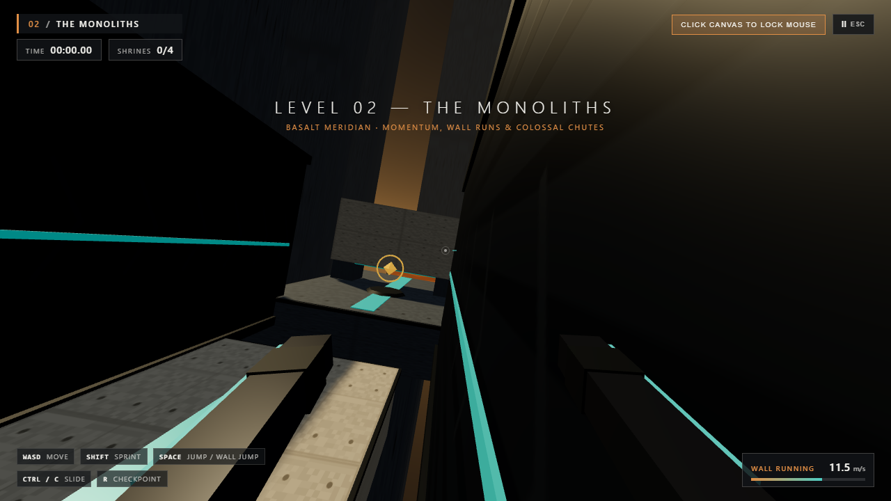

# 🏛️ FLOAT

A 3D first-person momentum parkour browser game built on **Three.js** and **Rapier3D (WASM)**, focused on fluid architectural traversal, contemplative brutalist monoliths, and minimalist aesthetic design.

[](https://floatparkour.vercel.app)
[](https://threejs.org/)
[](https://rapier.rs/)
[](https://github.com/Henrique-Teruya/3d-platform-game/actions)

> 🎮 **Play the live game right in your browser:** **[https://floatparkour.vercel.app](https://floatparkour.vercel.app)**  
> *(No install, no download, 100% client-side WebGL, works on Desktop and Mobile)*


*First-person view overlooking the Awakening Courtyard with architectural telemetry, speed reticle, and PCF soft shadows.*

---

## 🎮 Features

### 🏃 Movement & Physics
* **Custom Kinematic Character Controller** powered by `@dimforge/rapier3d-compat` (WASM) at a fixed 60Hz timestep.
* **Momentum Preservation:** Fluid air strafing with velocity preservation inspired by classic speedrunning mechanics.
* **Locomotion:** Progressive walking, running, and sprinting (`12.5 m/s`).
* **Jump Mechanics:** Variable jump height, **Coyote Time** (`120 ms`), and **Jump Input Buffering** (`140 ms`).
* **Slide & Ducking:** Momentum slide with real physical capsule height reduction (allowing the player to duck under low concrete lintels) and slope acceleration.
* **Wall Running & Wall Jumping:** Dynamic wall detection (`15°–75°` entry angles), camera tilt (`±11°`), and chained multi-wall jumps.
* **Moving Platforms:** Kinematic elevator platforms and moving bridges with physical velocity inheritance.

### 🏛️ World & Visuals
* **Monolithic Brutalism:** Monumental geometric scale, colossally proportioned pillars, and floating monoliths.
* **Procedural Materials:** Real-time generated 512x512 board-formed concrete bump/roughness textures, dark basalt, and stone tiles (zero image download overhead).
* **Atmospheric Lighting:** Custom GLSL tri-color sky dome + solar disc shader, exponential height fog (`THREE.FogExp2`), and `PCFSoftShadowMap`.
* **Extreme Performance Budget:** Only **68 draw calls** and **~5,000 triangles** rendered in scene via `THREE.InstancedMesh`.

### 🎵 Sound & Acoustics
* **100% Procedural Web Audio API Synth:** Zero external audio files to download.
* **Reactive Wind System:** Dynamic BiquadFilter frequency scaling based on player velocity and whistling wind at terminal velocities.
* **Generative Biome Drones:** Layered harmonic oscillator chords tailored to each architectural biome.
* **Kinetic Foley:** Concrete footstep clicks, tiered landing thuds, and shrine resonant bells.

### 🗺️ Scenarios & Progression
* **Level 01 — The Awakening:** Warm alabaster dawn, introductory gap jumps, slide clearances, and sanctuary climb.
* **Level 02 — The Monoliths:** Golden brutalist dusk, parallel monolith canyon wall runs, moving bridges, and express speedrunner lines.
* **Level 03 — The Ascension:** Cobalt ethereal zenith, synchronized floating elevator platforms, double vertical wall jumps, and final citadel portal.
* **Instant Checkpoints:** Glowing shrine beacons, void fall detection, and sub-150ms respawns with ethereal fade.

---

## 💻 Running on Your PC (Local Setup)

To run the project locally on your machine, follow these step-by-step instructions.

### Prerequisites
* [Node.js](https://nodejs.org/) (version 18 or higher recommended)
* `npm` (included with Node.js)
* Git

---

### Step-by-Step Instructions

#### 1. Open Your Terminal
Open **PowerShell**, **Command Prompt (CMD)**, or **Git Bash** on your computer.

#### 2. Navigate to Your Projects Directory
Choose or navigate to the folder where you want to keep the project:
```bash
cd C:\Users\henri\projects
```

#### 3. Clone the Repository
Clone the repository from GitHub:
```bash
git clone https://github.com/Henrique-Teruya/3d-platform-game.git
```

#### 4. Enter the Project Folder
Enter the project root directory:
```bash
cd 3d-platform-game
```
*(Or if you are already inside `jogo andre`: `cd "C:\Users\henri\projects\jogo andre"`)*

#### 5. Install Dependencies
Install all required packages (Three.js, Rapier3D, React, Zustand, Vite):
```bash
npm install
```
*(On Windows PowerShell, if execution policy blocks scripts, you can use: `npm.cmd install`)*

#### 6. Start the Local Development Server
Run the dev server:
```bash
npm run dev
```
*(Or on PowerShell: `npm.cmd run dev`)*

Your terminal will display:
```text
  VITE v6.4.5  ready in 580 ms

  ➜  Local:   http://127.0.0.1:5188/
```

#### 7. Open the Game in Your Browser
Open your browser and visit:
👉 **[http://127.0.0.1:5188/](http://127.0.0.1:5188/)**

> 🛠️ **Real-time Physics Tuning Panel:**  
> Access **[http://127.0.0.1:5188/?debug=1](http://127.0.0.1:5188/?debug=1)** to open the interactive `lil-gui` panel and tweak gravity, sprint speeds, jump velocity, coyote time, and wall run friction in real time!

---

### Additional Commands

| Command | Description |
| :--- | :--- |
| `npm run test:unit` | Run all 14 Vitest unit tests & full Rapier3D physics level simulation |
| `npm run test:e2e` | Run Playwright end-to-end tests (desktop, mobile & bot playtests) |
| `npm run build` | Compile the optimized production build into `./dist` |
| `npm run preview` | Preview the production build locally at `http://127.0.0.1:4188/` |

---

## 🕹️ Controls

| Action | Desktop (Keyboard & Mouse) | Mobile / Touch Screen |
| :--- | :--- | :--- |
| **Move / Air Strafe** | `W` `A` `S` `D` or `Arrow Keys` | Virtual Joystick (Bottom Left) |
| **Look (First-Person Camera)** | `Mouse` (Click Canvas to lock cursor) | Touch & Drag anywhere on screen |
| **Sprint (`12.5 m/s`)** | Hold `Shift` | Automatic at outer joystick limit |
| **Jump / Wall Jump** | `Spacebar` (Tap for low, hold for high) | `JUMP` Button |
| **Wall Run** | Jump into a wall at an angle holding `W` | Steer towards wall + Jump |
| **Slide (Crouch / Duck)** | `Ctrl` or `C` while moving | `SLIDE` Button |
| **Quick Respawn** | `R` | Pause Menu → Checkpoint |
| **Pause / Settings** | `Escape` or `P` | `II ESC` Button (Top Right) |

---

## 🏛️ Level Showcase

| Level | Atmosphere & Palette | Core Traversal Mechanics |
| :--- | :--- | :--- |
| **01 — The Awakening** | Warm Alabaster Dawn (`#e08e45`) | Basic jumps, slide clearances under low lintels, introduction to wall runs |
| **02 — The Monoliths** | Golden Brutalist Dusk (`#d4a373`) | Canyon wall runs, moving elevator platforms, downhill slide acceleration |
| **03 — The Ascension** | Cobalt Ethereal Zenith (`#5b8fb9`) | Suspended platforms, chained double-wall jumps, precision aerial jumps |


*Chained wall run traversal along monolithic basalt canyon walls.*

---

## 🏗️ Tech Stack & Architecture

* **Engine Core:** TypeScript, Vite, React 19, Zustand
* **3D Rendering:** Three.js (r172)
* **Physics:** `@dimforge/rapier3d-compat` (WASM Kinematic Character Controller)
* **Audio Engine:** Custom procedural synthesizer using standard Web Audio API
* **Testing:** Vitest (unit & physics simulations) + Playwright (cross-browser E2E & automated bot playtesting)
* **Hosting / CI:** Vercel (`vercel.json`) & GitHub Actions (`.github/workflows/deploy.yml`)

---

## 📚 Complete Project Documentation (`docs/`)

The repository includes a comprehensive 8-module architectural and game design bible in the `docs/` folder:

| Module | Document | Description |
| :--- | :--- | :--- |
| **01. Vision & Pillars** | [`docs/01-vision-and-creative-direction/`](docs/01-vision-and-creative-direction/) | Core game pillars, emotional tone, and liminal world lore. |
| **02. Art & WebGL Budget** | [`docs/02-art-and-visual-direction/`](docs/02-art-and-visual-direction/) | Brutalist styleguide, lighting specs, and WebGL rendering budgets. |
| **03. Movement & Physics** | [`docs/03-gameplay-and-character-controller/`](docs/03-gameplay-and-character-controller/) | Vector formulas, coyote time, buffering, slide curves, and constants sheet. |
| **04. Level Design** | [`docs/04-level-design/`](docs/04-level-design/) | Metric bounding boxes, modular kit, route pacing, and biome specs. |
| **05. Audio Design** | [`docs/05-audio-design/`](docs/05-audio-design/) | Acoustic foley, dynamic wind filtering, and procedural sound synthesis. |
| **06. UX & Accessibility** | [`docs/06-ux-and-ui/`](docs/06-ux-and-ui/) | Architectural HUD, mobile controls, and motion sickness comfort settings. |
| **07. Software Architecture** | [`docs/07-technical-architecture/`](docs/07-technical-architecture/) | Decoupled 60Hz loop, state machines, and GC optimization. |
| **08. QA & Verification** | [`docs/08-ai-implementation-roadmap/`](docs/08-ai-implementation-roadmap/) | Verification reports, test metrics, and [`IMPLEMENTATION_STATUS.md`](docs/IMPLEMENTATION_STATUS.md). |

---

## 📄 License

This project is open-source under the [MIT License](LICENSE). Contributions, experiments, and feedback are welcome!
