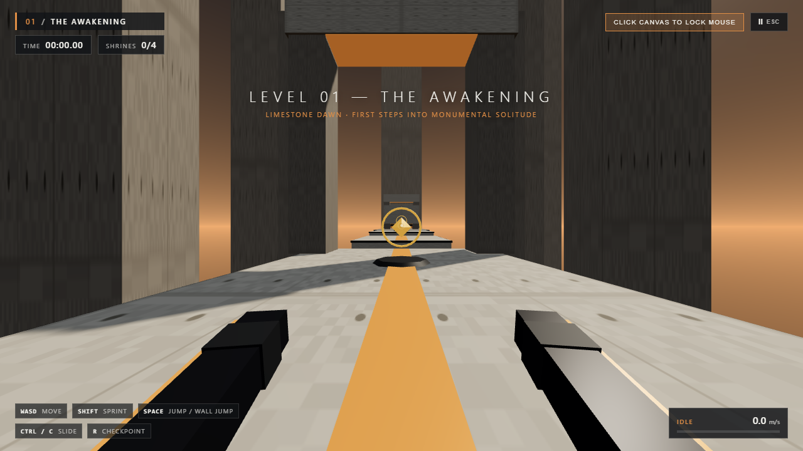

# 🏛️ FLOAT

Um jogo 3D de parkour em primeira pessoa para navegadores construído com **Three.js** e **Rapier3D (WASM)**, focado em movimentação fluida com conservação de momentum, arquitetura brutalista monumental e estética minimalista contemplativa.

[English](README.md) | [Português (Brasil)](README.pt-BR.md)

[](https://floatparkour.vercel.app)
[](https://threejs.org/)
[](https://rapier.rs/)
[](https://github.com/Henrique-Teruya/3d-platform-game/actions)

> 🎮 **Jogue direto pelo navegador:** **[https://floatparkour.vercel.app](https://floatparkour.vercel.app)**  
> *(Sem downloads, 100% WebGL no cliente, compatível com Desktop e Celulares)*


*Visão em primeira pessoa sobre o Pátio do Despertar com telemetria arquitetônica, retículo de velocidade e sombras suaves PCF.*

---

## 🎮 Funcionalidades

### 🏃 Movimentação & Física
* **Controlador Cinemático Próprio:** alimentado por `@dimforge/rapier3d-compat` (WASM) a 60 Hz cravados.
* **Preservação de Momentum:** Air strafe fluido com conservação de velocidade no ar estilo Quake/Source.
* **Locomoção:** Caminhada, corrida e sprint progressivo (`12.5 m/s`).
* **Mecânica de Pulo:** Altura variável de salto, **Coyote Time** (`120 ms`) e **Jump Input Buffering** (`140 ms`).
* **Slide & Agachamento:** Deslize de momentum com redução física real da cápsula (permitindo passar por baixo de vigas baixas de concreto) e aceleração em rampas descendentes.
* **Wall Running & Wall Jumping:** Detecção dinâmica de paredes (ângulos de entrada de `15°–75°`), inclinação de câmera (`±11°`) e pulos encadeados entre paredes opostas.
* **Plataformas Móveis:** Elevadores e pontes cinemáticas móveis com herança física de velocidade no salto.

### 🏛️ Universo & Visual
* **Brutalismo Monumental:** Escala geométrica ciclópica, colunatas gigantescas e monólitos flutuantes.
* **Materiais Procedurais:** Texturas geradas em tempo real em memória (concreto ripado 512x512, basalto e ladrilhos) — zero downloads de imagens externas.
* **Iluminação Atmosférica:** Shader GLSL de domo celeste tricolor com disco solar, névoa exponencial (`THREE.FogExp2`) e sombras suaves (`PCFSoftShadowMap`).
* **Orçamento Gráfico Leve:** Apenas **68 draw calls** e **~5.000 triângulos** renderizados via `THREE.InstancedMesh`.

### 🎵 Áudio & Acústica
* **Sintetizador 100% Procedural na Web Audio API:** Nenhum arquivo de áudio para baixar.
* **Vento Dinâmico Reativo:** Filtro passa-baixa Biquad escalonado pela velocidade do jogador e assobio de vento em altas velocidades.
* **Drones Harmônicos Generativos:** Acordes contínuos por osciladores sintetizados de acordo com cada bioma arquitetônico.
* **Foley Cinético:** Passos em concreto, impacto de aterrissagem em múltiplos níveis e sinos harmônicos nos santuários.

### 🗺️ Fases & Progressão
* **Fase 01 — O Despertar (The Awakening):** Alvorecer quente em alabastro, travessia de fendas, lintéis baixos para slide e ascensão ao santuário.
* **Fase 02 — Os Monólitos (The Monoliths):** Entardecer dourado brutalista, wall runs encadeados em desfiladeiros de monólitos, plataformas móveis e rota expressa para speedrunners.
* **Fase 03 — A Ascensão (The Ascension):** Zênite cobalto etéreo, plataformas flutuantes sincronizadas, wall jumps duplos verticais e portal final da Cidadela.
* **Checkpoints Instantâneos:** Santuários iluminados, detecção de queda no abismo e respawn imediato (<150 ms) com transição etérea suave.

---

## 💻 Como Rodar no seu Computador (Guia Local)

### Pré-requisitos
* [Node.js](https://nodejs.org/) (versão 18 ou superior)
* `npm`
* Git

---

### Passo a Passo

#### 1. Abra o Terminal
Abra o **PowerShell**, **Prompt de Comando (CMD)** ou **Git Bash**.

#### 2. Vá até a pasta de projetos
```bash
cd C:\Users\henri\projects
```

#### 3. Clone o Repositório
```bash
git clone https://github.com/Henrique-Teruya/3d-platform-game.git
```

#### 4. Entre na pasta do projeto
```bash
cd 3d-platform-game
```
*(Ou se já estiver na pasta local: `cd "C:\Users\henri\projects\jogo andre"`)*

#### 5. Instale as dependências
```bash
npm install
```
*(No PowerShell do Windows, você pode usar `npm.cmd install`)*

#### 6. Inicie o Servidor Local
```bash
npm run dev
```
*(No PowerShell: `npm.cmd run dev`)*

O terminal exibirá:
```text
  VITE v6.4.5  ready in 580 ms

  ➜  Local:   http://127.0.0.1:5188/
```

#### 7. Abra no Navegador
Acesse:
👉 **[http://127.0.0.1:5188/](http://127.0.0.1:5188/)**

> 🛠️ **Painel de Tuning Físico em Tempo Real:**  
> Acesse **[http://127.0.0.1:5188/?debug=1](http://127.0.0.1:5188/?debug=1)** para abrir o menu `lil-gui` e ajustar gravidade, velocidade de corrida, força de pulo, coyote time e atrito na parede em tempo real!

---

## 🕹️ Controles

| Ação | Desktop (Teclado e Mouse) | Celular / Touch |
| :--- | :--- | :--- |
| **Mover / Air Strafe** | `W` `A` `S` `D` ou `Setas` | Joystick Virtual (Canto Inferior Esquerdo) |
| **Olhar (Câmera 1ª Pessoa)** | `Mouse` (Clique no canvas para travar o cursor) | Toque e arraste em qualquer parte |
| **Sprint (`12.5 m/s`)** | Segurar `Shift` | Automático no limite do joystick |
| **Pular / Wall Jump** | `Espaço` (Toque curto = baixo, segurar = alto) | Botão `JUMP` |
| **Wall Run** | Pular em uma parede em ângulo segurando `W` | Direcionar para a parede + Pulo |
| **Slide (Deslizar / Agachar)** | `Ctrl` ou `C` em movimento | Botão `SLIDE` |
| **Voltar ao Checkpoint** | `R` | Menu de Pausa → Checkpoint |
| **Pausar / Configurações** | `Esc` ou `P` | Botão `II ESC` (Canto Superior Direito) |

---

## 📄 Licença

Este projeto é de código aberto sob a licença [MIT](LICENSE).

---

## ⚡ Guia de Otimização e Fluidez

Para entender as 10 regras de ouro que mantêm o jogo rodando a 60 FPS lisos sem travamentos em qualquer celular ou PC modesto (zero Garbage Collection, texturas procedurais, áudio sintetizado e limite de DPR), consulte o manual obrigatório:
👉 **[`docs/PERFORMANCE_AND_OPTIMIZATION_GUIDE.md`](docs/PERFORMANCE_AND_OPTIMIZATION_GUIDE.md)**
