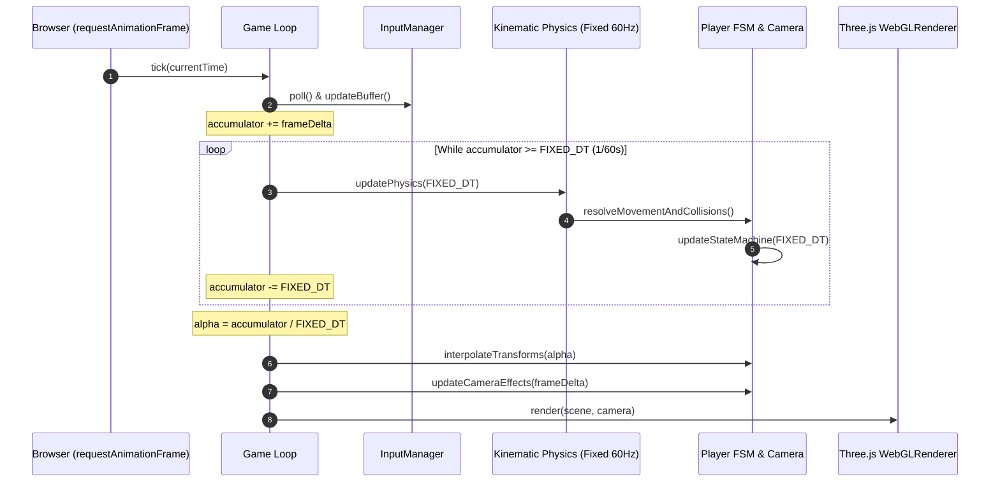

# ARQUITETURA TÉCNICA: STACK DE TECNOLOGIA E ARQUITETURA DE SOFTWARE
**Documento:** ARCH-DOC-001  
**Responsáveis:** Software Architect & Gameplay Programmer  
**Status:** Aprovado para Implementação Futura

---

## 1. Stack Tecnológico

O projeto é desenvolvido para a web moderna, utilizando uma stack leve, determinística e com zero dependências de frameworks pesados de interface (sem React/Vue no loop principal do jogo, usando manipulação DOM limpa e direta para a interface).

```
┌────────────────────────────────────────────────────────────────────────┐
│                         STACK TECNOLÓGICO                              │
├────────────────────┬────────────────────┬──────────────────────────────┤
│ 1. LINGUAGEM       │ 2. ENGINE GRÁFICA  │ 3. FÍSICA CINEMÁTICA         │
│ TypeScript 5.x     │ Three.js r165+     │ Rapier3D / Custom Kinematic  │
│ (Strict Mode Ativo)│ (WebGL 2.0 PBR)    │ Raycasts e Shapecasts        │
├────────────────────┼────────────────────┼──────────────────────────────┤
│ 4. BUNDLER & DEV   │ 5. ÁUDIO ENGINE    │ 6. TESTES & VALIDAÇÃO        │
│ Vite 5.x           │ Web Audio API      │ Vitest (Lógica de Física)    │
│ (HMR Instantâneo)  │ (Modular / Foley)  │ Playwright (Testes de Tela)  │
└────────────────────┴────────────────────┴──────────────────────────────┘
```

---

## 2. Estrutura Canônica de Diretórios do Projeto

A base de código deve ser estritamente organizada sob a pasta `src/`, respeitando a separação de responsabilidades entre renderização gráfica, física, regras de jogo e áudio:

```
src/
├── core/                         # Núcleo da aplicação e loop de jogo
│   ├── Game.ts                   # Orquestrador mestre (Lifecycle, Init, Loop)
│   ├── Time.ts                   # Gerenciador de Delta Time fixo e variável
│   └── EventBus.ts               # Barramento desacoplado de eventos pub/sub
│
├── input/                        # Sistema de entrada e Pointer Lock
│   ├── InputManager.ts           # Leitura unificada de teclado e mouse
│   ├── InputBuffer.ts            # Registro de intenções com timestamp (Buffering)
│   └── KeyBindings.ts            # Mapeamento de teclas e persistência local
│
├── physics/                      # Motor cinemático e detecção de colisões
│   ├── KinematicController.ts    # Resolvedor de Slide & Collide do jogador
│   ├── CapsuleCollider.ts        # Bounding box cilíndrica/cápsula
│   ├── RaycastHelper.ts          # Disparos de raios (Ground & Wall checks)
│   └── SlopeCalculator.ts        # Projeção de normais e aceleração em declives
│
├── gameplay/                     # Mecânicas de parkour e regras de jogo
│   ├── player/
│   │   ├── PlayerCharacter.ts    # Entidade do jogador (posição, vetores)
│   │   ├── PlayerStateMachine.ts # FSM de estados (Idle, Run, Slide, WallRun)
│   │   ├── PlayerCamera.ts       # Sistema de câmera, FOV dinâmico e tilts
│   │   └── movementConfig.ts     # Constantes numéricas de calibração
│   ├── world/
│   │   ├── CheckpointManager.ts  # Gerenciamento de checkpoints e respawn
│   │   └── LevelLoader.ts        # Carregamento de zonas e peças modulares
│   └── speedrun/
│       └── RunTimer.ts           # Cronômetro de precisão para modo desafio
│
├── rendering/                    # Gráficos, cenas e pós-processamento Three.js
│   ├── SceneManager.ts           # Configuração de Three.Scene, Câmera e Canvas
│   ├── LightingRig.ts            # Luz direcional solar, sombras e Hemisphere
│   ├── SkyAndFog.ts              # Domo de céu com gradiente e FogExp2
│   ├── PostProcessing.ts         # Passagens enxutas de pós-processamento
│   └── materials/                # Materiais PBR mestres (Concreto, Basalto)
│       └── MasterMaterialLibrary.ts
│
├── audio/                        # Som dinâmico e foley
│   ├── AudioManager.ts           # Inicialização e master buses da Web Audio API
│   ├── FoleyController.ts        # Passos, raspadas de slide e impacto de pouso
│   ├── WindSynthesizer.ts        # Vento procedural sintetizado por velocidade
│   └── AmbiencePlayer.ts         # Drones harmônicos e reverberação de ambiente
│
└── ui/                           # HUD minimalista e menus em HTML/CSS
    ├── HUDView.ts                # Retícula central, velocímetro e checkpoints
    ├── PauseMenuView.ts          # Menu de configurações e acessibilidade
    └── OverlayFade.ts            # Cortina suave para transição de respawn
```

---

## 3. Diagrama do Game Loop Desacoplado

O loop principal desacopla completamente a taxa de quadros visual da lógica física, garantindo comportamento mecânico idêntico em telas de 60Hz, 120Hz, 144Hz ou 240Hz:



---

## 4. Comunicação Desacoplada por EventBus

Nenhum módulo de gameplay referencia diretamente a engine de áudio ou a interface. Todas as mensagens transitam por um barramento de eventos tipado (`EventBus`):

| Evento | Payload | Ouvintes |
| :--- | :--- | :--- |
| `PLAYER_JUMPED` | `{ velocity: number, isWallJump: boolean }` | `FoleyController`, `PlayerCamera` |
| `PLAYER_LANDED` | `{ fallSpeed: number, surfaceType: string }` | `FoleyController`, `PlayerCamera` |
| `PLAYER_SLIDE_START` | `{ currentSpeed: number }` | `FoleyController`, `HUDView` |
| `PLAYER_CHECKPOINT_REACHED` | `{ checkpointId: string, zoneName: string }`| `HUDView`, `AmbiencePlayer` |
| `PLAYER_VOID_FALL` | `{ respawnPosition: Vector3 }` | `OverlayFade`, `FoleyController` |
