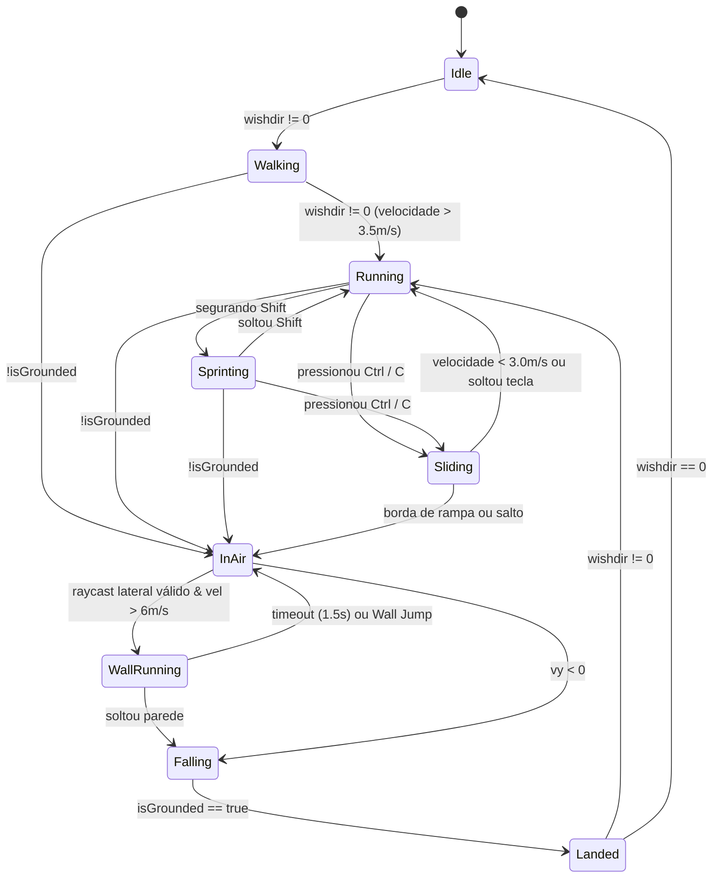

# ARQUITETURA TÉCNICA: MÁQUINAS DE ESTADO E ESTRUTURAS DE DADOS
**Documento:** ARCH-DOC-002  
**Responsáveis:** Software Architect & Gameplay Programmer  
**Status:** Aprovado

---

## 1. Máquina de Estados Finitos do Jogador (Player FSM)

O comportamento do jogador é governado por uma Máquina de Estados Finitos (FSM) estrita e hierárquica. Isso impede estados inválidos (ex: correr na parede enquanto está deslizando no chão).



### 1.1 Tabela de Transições de Estado

| Estado Atual | Condição de Transição | Próximo Estado | Efeito de Entrada / Saída |
| :--- | :--- | :--- | :--- |
| **`IDLE`** | `wishdir.lengthSq() > 0` | `RUNNING` | Inicia aceleração de solo. |
| **`RUNNING`** | `input.isSprinting` | `SPRINTING` | Eleva $V_{max}$ para $11.0\text{ m/s}$. |
| **`RUNNING` / `SPRINTING`** | `input.isSliding && speed > 5.0` | `SLIDING` | Reduz altura da cápsula ($0.9\text{ m}$), reduz atrito ($\mu = 0.8$). |
| **`SLIDING`** | `speed < 2.5 \|\| !input.isSliding` | `RUNNING` | Restaura altura da cápsula com sweep vertical preventivo. |
| **`QUALQUER ESTADO DE SOLO`** | `!isGrounded && jumpTriggered` | `JUMPING` | Aplica $v_y = 8.4\text{ m/s}$, desativa ground snap. |
| **`QUALQUER ESTADO DE SOLO`** | `!isGrounded && !jumpTriggered` | `FALLING` | Dispara temporizador de **Coyote Time** ($0.12\text{ s}$). |
| **`FALLING` / `JUMPING`** | `wallRayHit && speed > 6.0 && canWallRun` | `WALL_RUNNING` | Gravidade reduzida ($0.25\times$), inclina câmera ($10^\circ$). |
| **`WALL_RUNNING`** | `input.jumpTriggered` | `JUMPING` | Impulso de repulsão lateral + vertical. |
| **`WALL_RUNNING`** | `timer > 1.5s \|\| !wallRayHit` | `FALLING` | Restaura gravidade normal, desfaz roll de câmera. |
| **`FALLING`** | `isGrounded == true` | `LANDED` | Emite evento de impacto sonoro e compressão de câmera. |

---

## 2. Estrutura de Dados do Input Buffer

O buffer de entrada desacopla os eventos assíncronos do teclado/mouse do tick de física fixa de 60Hz:

```typescript
export interface InputState {
  wishDir: THREE.Vector3;        // Direção horizontal desejada normalizada
  isSprinting: boolean;          // Tecla Shift ativa
  isSliding: boolean;            // Tecla Ctrl/C ativa
  jumpRequested: boolean;        // Space disparado recentemente
  jumpBufferTimer: number;       // Janela de buffer (segundos restantes)
  lookDeltaX: number;            // Movimento do mouse X do frame
  lookDeltaY: number;            // Movimento do mouse Y do frame
  timestamp: number;             // Momento exato da captura (performance.now)
}
```

- Quando a tecla `Space` é pressionada, `jumpBufferTimer` é setado para `0.10` segundos.
- A cada tick de física, o timer é subtraído por $\Delta t$. Se o jogador tocar no solo com `jumpBufferTimer > 0`, o salto é consumido instantaneamente.

---

## 3. Esquema de Dados de Nível e Checkpoints (Level Schema)

As fases e setores são definidos em arquivos de dados declarativos tipados, permitindo que novos trajetos de parkour sejam carregados sem alterar código:

```typescript
export interface CheckpointData {
  id: string;
  zoneId: string;
  position: [number, number, number];
  yawRotation: number;
  triggerRadius: number;
}

export interface ModularInstanceData {
  pieceId: string;               // Ex: 'MOD_SLAB_08x08'
  position: [number, number, number];
  rotation: [number, number, number]; // Euler em graus
  scale?: [number, number, number];
}

export interface ZoneDefinition {
  zoneId: string;
  zoneName: string;
  biomeType: 'limestone' | 'basalt' | 'sand' | 'violet_dusk';
  skyColors: {
    top: string;
    horizon: string;
    bottom: string;
  };
  fogDensity: number;
  voidKillY: number;
  checkpoints: CheckpointData[];
  instances: ModularInstanceData[];
}
```
Esse formato modular desacoplado permite que a IA ou designers criem ferramentas de geração procedural de fases ou importem arquivos JSON de layout diretamente.
